# 🧩 Components - Exercises XP Ninja

The React components for Exercises XP Ninja.

## Contents

- [`MouseTracker.jsx`](MouseTracker.jsx)
- [`StarRating.jsx`](StarRating.jsx)
- [`Tabs.jsx`](Tabs.jsx)

---

## 👤 Author

**Kevin Cusnir 'Lirioth'**  
Repository: [Fullstack2026](https://github.com/LiriothTeltanion/Fullstack2026)  
Week 8 Day 1 - Multiple Components and Events - Exercises XP Ninja
