# 💪 Daily Challenge - Data and Server

<div align="center">




</div>

React and Express talking to each other: the client reads a greeting from `GET /api/hello` and sends a form to `POST /api/world`, which answers with what it received.

## ▶️ How to run

Two terminals:

```bash
# terminal 1: the API on port 5000
cd server
npm install
npm start

# terminal 2: the React client
cd client
npm install
npm run dev
```

The Vite dev server forwards every `/api` request to `http://localhost:5000` (see `client/vite.config.js`), so the client uses short URLs and there is no CORS problem.

I tested the API with curl:

```
GET  /api/hello  -> {"message":"Hello From Express"}
POST /api/world  {"post":"hi from curl"}
                 -> {"message":"I received your POST request. This is what you sent me: hi from curl"}
POST /api/world  {"post":""}  -> 400 {"error":"Please type something first."}
```

## 🎯 The challenge

| Part | What it does |
|---|---|
| `server/server.js` | Express with `cors`, `express.json()` and the router mounted on `/api`; the port comes from `.env` (`PORT`, default 5000) |
| `server/routes/api.js` | `GET /hello` returns the greeting; `POST /world` validates `post` and echoes it back |
| `client/src/App.jsx` | Part 1 fetches the greeting in `useEffect` and shows it as the `<h1>`. Part 2 posts the input as JSON and prints the server's reply |

## 🧠 What I learned

- A Vite proxy lets the client call `/api/...` as if the API lived on the same origin
- `express.json()` is what fills `req.body`; without it the POST arrives empty
- Sending a 400 with an error message is easier to show in React than a crash
- The client checks `response.ok` before deciding which message to print

---

## 👤 Author

**Kevin Cusnir 'Lirioth'**  
Repository: [Fullstack2026](https://github.com/LiriothTeltanion/Fullstack2026)  
Week 8 Day 2 - Advanced React - Daily Challenge
