# 🖥️ Server - Data and Server

The Express back end for Data and Server.

## Contents

- [`routes/`](routes/)
- [`.env.example`](.env.example)
- [`package.json`](package.json)
- [`server.js`](server.js)

---

## 👤 Author

**Kevin Cusnir 'Lirioth'**  
Repository: [Fullstack2026](https://github.com/LiriothTeltanion/Fullstack2026)  
Week 8 Day 2 - Advanced React - Daily Challenge
