# 💪 Daily Challenge - Form

<div align="center">




</div>

A class-based country autocomplete with keyboard and pointer selection, plus the original sign-up form with client-side validation. Both run locally without sending or saving input. In the retained sign-up example, errors show after leaving a field or pressing "Sign up"; a valid form resets and greets the synthetic visitor.

## ▶️ How to run

```bash
npm ci
npm run dev
```

Vite prints a local address (usually `http://localhost:5173`); I open it in the browser.

## 🎯 The challenge

| Part               | What it does                                                                                                                                                                                                               |
| ------------------ | -------------------------------------------------------------------------------------------------------------------------------------------------------------------------------------------------------------------------- |
| `validate(values)` | In `src/validate.js`. Returns one message per broken rule: username under 3 characters, an email that fails the regex, a password without 8 characters and a digit, a confirmation that does not match, terms not accepted |
| `SignUpForm`       | Keeps `values`, `touched` and `submitted` in state. Errors are recalculated on every render; `show(name)` hides them until the field was touched                                                                           |
| `Field`            | A reusable label, input and error message, with `aria-invalid` so a broken field gets a red border                                                                                                                         |

## 🧠 What I learned

- Errors do not need their own state when I can calculate them from the values
- A `touched` object stops the form from shouting at the user before they type
- `noValidate` turns off the browser bubbles so my own messages are the only ones
- Pulling the input markup into `Field` removed a lot of repeated JSX

---

## 👤 Author

**Kevin Cusnir 'Lirioth'**  
Repository: [Fullstack2026](https://github.com/LiriothTeltanion/Fullstack2026)  
Week 8 Day 2 - Advanced React - Daily Challenge

## Country autocomplete · additive exercise update

The original sign-up example above is preserved. The first section now implements
an original country autocomplete as a React **class component**,
`src/components/CountryAutocomplete.jsx`. It owns the typed query, open state,
active keyboard option and selected country. `src/countries.js` provides a locally
authored, frozen demonstration list of 56 country names and a pure prefix filter.
It is not an exhaustive international country or territory catalog.

Type a case-insensitive prefix such as `is`, `un` or `ca`. Choose a suggestion with
the pointer, or use ArrowDown/ArrowUp, Home/End and Enter. Escape closes the list
without losing the query. Tab moves on normally; leaving the widget closes the
list. Clear resets the selection and returns focus to the input. Empty input and
no matches have explicit messages. Matching tolerates outer whitespace and
combining accents while retaining original labels. The input uses the combobox /
listbox pattern with a visible label, active option and polite status feedback.
No query, country, password or email is stored or sent. The sign-up section remains
a local validation demo, not a backend account service.

```bash
npm ci
npm test
npm run build
npm run dev
```

`npm test` runs five Node behavior tests for country filtering/data and the
preserved sign-up validator. These tests do not mount React. Real browser QA also
checks the rendered class component, pointer/keyboard flow and retained sign-up
behavior at desktop and narrow widths. No third-party course source, stylesheet,
illustration or private assignment text is bundled. This README describes the
implemented scope; publication and any academic completion are separate steps.

Built with AI-assisted tooling; I reviewed, tested and can explain every change.
