# 🧩 Components - Form

The React components for Form.

## Contents

- [`Field.jsx`](Field.jsx)
- [`SignUpForm.jsx`](SignUpForm.jsx)

---

## 👤 Author

**Kevin Cusnir 'Lirioth'**  
Repository: [Fullstack2026](https://github.com/LiriothTeltanion/Fullstack2026)  
Week 8 Day 2 - Advanced React - Daily Challenge
