# 💪 Daily Challenges

A React client with an Express API, and a validated sign-up form.

## Contents

- [`DataAndServer/`](DataAndServer/): Data and Server: React client calling GET and POST routes in Express
- [`Form/`](Form/): Form: sign-up form with live validation

---

## 👤 Author

**Kevin Cusnir 'Lirioth'**  
Repository: [Fullstack2026](https://github.com/LiriothTeltanion/Fullstack2026)  
Week 8 Day 2 - Advanced React - Daily Challenges
