# 🥉 Exercises XP

<div align="center">




</div>

Routing, local JSON files and a `POST` request, all in one Vite app. The shop page breaks on purpose so the error boundary has something to catch.

## ▶️ How to run

```bash
npm install
npm run dev
```

Vite prints a local address (usually `http://localhost:5173`); I open it in the browser.

For exercise 4 I copy `.env.example` to `.env` and paste my own address from webhook.site into `VITE_WEBHOOK_URL`, then restart `npm run dev`.

## 🎯 The challenge

1. **React Router**: a `NavLink` bar for Home, Profile and Shop. Every route is wrapped in an `ErrorBoundary`, and `ShopScreen` throws, so `/shop` shows "An error has occurred." while the other pages keep working.
2. **Display JSON data**: `PostList` imports `src/data/posts.json` and maps each post to a title and text.
3. **Complex JSON**: `Example1`, `Example2` and `Example3` read `complexData.json` and render social links, skills grouped by area (hot ones get 🔥) and work experience with roles.
4. **POST with fetch**: `WebhookPost` sends `{ key1, email, name }` as JSON with `async/await` and prints the response status. Without the env variable it explains what to add.

## 🧠 What I learned

- Vite can `import` a JSON file like a module, no `fetch` needed for local data
- `NavLink` adds an `active` class by itself, so the current page is easy to style
- Nested `map()` calls follow the shape of the JSON: areas, then skills inside each area
- Only variables that start with `VITE_` reach the browser code through `import.meta.env`

---

## 👤 Author

**Kevin Cusnir 'Lirioth'**  
Repository: [Fullstack2026](https://github.com/LiriothTeltanion/Fullstack2026)  
Week 8 Day 2 - Advanced React - Exercises XP
