# 📁 Screens - Exercises XP

Part of the project for Exercises XP.

## Contents

- [`HomeScreen.jsx`](HomeScreen.jsx)
- [`ProfileScreen.jsx`](ProfileScreen.jsx)
- [`ShopScreen.jsx`](ShopScreen.jsx)

---

## 👤 Author

**Kevin Cusnir 'Lirioth'**  
Repository: [Fullstack2026](https://github.com/LiriothTeltanion/Fullstack2026)  
Week 8 Day 2 - Advanced React - Exercises XP
