# 🥇 Exercises XP Gold

<div align="center">




</div>

The class component lifecycle, step by step, and then the same color example rewritten with hooks to compare.

## ▶️ How to run

```bash
npm install
npm run dev
```

Vite prints a local address (usually `http://localhost:5173`); I open it in the browser.

The lifecycle messages go to the browser console.

Use Node 22.13+ on the 22.x line, or Node 24+. The locked tooling uses Vite 8
and its compatible React plugin while retaining React 18.3.1. Run `npm ci`
after cloning to install the locked dependencies, then `npm test`
for four offline React integration checks. They cover normal color updates,
the visible-color snapshot after blocked renders, StrictMode cleanup without
false alerts, and exactly one alert after Delete, using a simulated clock.
The tests compile JSX in memory and write no project files. Run `npm run build`
separately to verify the production bundle. See [tests/README.md](tests/README.md).

## 🎯 The challenge

1. **Lifecycle methods**: `FavoriteColor` starts red, and `componentDidMount` switches it to yellow after one second. `shouldComponentUpdate` blocks re-renders while the "Allow updates" box is unchecked, `getSnapshotBeforeUpdate` reads the previously visible color from a DOM ref and `componentDidUpdate` logs the visible change. State may still change while rendering is blocked; re-enabling updates compares against the text the reader actually saw.
2. **Unmounting**: the "Delete" button marks an intentional removal and unmounts `Child`. `Child.componentWillUnmount` consumes that marker and announces `Child` once. Cleanup without an explicit Delete only logs; development StrictMode can replay supported setup/cleanup lifecycles, so no deletion alert is tied to those replays.
3. **The same with hooks**: `ColorWithHooks` does the timer with `useEffect(..., [])` and a cleanup, and logs each change with a second effect that depends on `favoriteColor`.

## 🧠 What I learned

- `componentDidMount` sets up mount work, like an effect with an empty array. Development StrictMode can replay setup and cleanup to expose missing cleanup; production mounts do not include that development replay
- Returning `false` from `shouldComponentUpdate` skips the render even when the state changed
- The DOM snapshot returned by `getSnapshotBeforeUpdate` arrives as the third argument of `componentDidUpdate`, preserving the visible transition even after skipped renders
- Clearing the timer on unmount avoids setting state on a component that is gone

---

## 👤 Author

**Kevin Cusnir 'Lirioth'**  
Repository: [Fullstack2026](https://github.com/LiriothTeltanion/Fullstack2026)  
Week 8 Day 2 - Advanced React - Exercises XP Gold
