# 🧩 Components - Exercises XP Gold

The React components for Exercises XP Gold.

## Contents

- [`Child.jsx`](Child.jsx)
- [`ColorWithHooks.jsx`](ColorWithHooks.jsx)
- [`FavoriteColor.jsx`](FavoriteColor.jsx)

---

## 👤 Author

**Kevin Cusnir 'Lirioth'**  
Repository: [Fullstack2026](https://github.com/LiriothTeltanion/Fullstack2026)  
Week 8 Day 2 - Advanced React - Exercises XP Gold
