# 🥷 Exercises XP Ninja

<div align="center">




</div>

I wrote a small `useFetch` hook and used it three times against JSONPlaceholder: one todo at a time, a searchable user list and paginated posts.

## ▶️ How to run

```bash
npm install
npm run dev
```

Vite prints a local address (usually `http://localhost:5173`); I open it in the browser.

It needs an internet connection for `jsonplaceholder.typicode.com`.

## 🎯 The challenge

| Part            | What it does                                                                                                                                    |
| --------------- | ----------------------------------------------------------------------------------------------------------------------------------------------- |
| `useFetch(url)` | Returns `{ data, loading, error }`. It refetches when `url` changes and uses an `ignore` flag so a slow old answer cannot overwrite a newer one |
| `TodoPreview`   | Previous and Next buttons change the todo id, which changes the URL, which triggers a new request                                               |
| `UserSearch`    | Fetches the users once and filters them by name on every keystroke, with a "3 of 10 users" counter                                              |
| `PagedPosts`    | Shows 5 of the 100 posts per page, with `slice()` and disabled buttons on the first and last page                                               |

## 🧠 What I learned

- A custom hook is just a function that starts with `use` and calls other hooks
- Putting `url` in the dependency array is what makes the hook refetch
- The cleanup function of an effect is the right place to cancel interest in a late response
- Filtering and paging fetched data are plain array work, no extra requests

---

## 👤 Author

**Kevin Cusnir 'Lirioth'**  
Repository: [Fullstack2026](https://github.com/LiriothTeltanion/Fullstack2026)  
Week 8 Day 2 - Advanced React - Exercises XP Ninja

## Request states and regression checks

The hook clears the previous result when a new URL starts loading. If that request fails, the UI shows its error without presenting the previous task as the current result. A later successful URL clears the error; the existing users and posts remain independent. Responses from a previous URL are ignored after cleanup.

Users and posts expose initial loading and request errors. Reloading the page retries those initial requests; this exercise does not add a separate Retry button.

The browser suite in [`tests/`](tests/README.md) runs against the production build with synthetic intercepted API responses, including slow responses, HTTP/network errors, recovery, filtering and all 20 pages. It does not depend on the public API being online.
