# 🎮 Mini Project - Users and Posts

<div align="center">




</div>

A two-page React Router app on top of JSONPlaceholder: the home page lists the users as cards, and clicking one opens `/users/:userId` with that person's details and posts.

## ▶️ How to run

```bash
npm install
npm run dev
```

Vite prints a local address (usually `http://localhost:5173`); I open it in the browser.

## 🎯 The challenge

| File | What it does |
|---|---|
| `src/api.js` | `getUsers`, `getUser(id)` and `getPostsByUser(id)` share one `getJson` helper that throws on a bad status |
| `UserList` | Loads the users in `useEffect` and shows loading, error or a grid of linked cards |
| `UserPosts` | Reads `userId` with `useParams`, loads the user and the posts together with `Promise.all`, and lists every post |
| `App` | Routes `/`, `/users/:userId` and a `*` "Page not found." fallback |

## 🧠 What I learned

- `useParams` turns part of the URL into a variable my component can use
- `Promise.all` starts both requests at the same time instead of one after the other
- Keeping the fetch calls in `api.js` made the components shorter and the URLs easy to change
- Adding `userId` to the dependency array reloads the page data when I go to another user

---

## 👤 Author

**Kevin Cusnir 'Lirioth'**  
Repository: [Fullstack2026](https://github.com/LiriothTeltanion/Fullstack2026)  
Week 8 Day 2 - Advanced React - Mini Project
