# 📦 Source - Users and Posts

The source code for Users and Posts.

## Contents

- [`components/`](components/)
- [`App.jsx`](App.jsx)
- [`api.js`](api.js)
- [`index.css`](index.css)
- [`main.jsx`](main.jsx)

---

## 👤 Author

**Kevin Cusnir 'Lirioth'**  
Repository: [Fullstack2026](https://github.com/LiriothTeltanion/Fullstack2026)  
Week 8 Day 2 - Advanced React - Mini Project
