# 🧩 Components - Users and Posts

The React components for Users and Posts.

## Contents

- [`UserList.jsx`](UserList.jsx)
- [`UserPosts.jsx`](UserPosts.jsx)

---

## 👤 Author

**Kevin Cusnir 'Lirioth'**  
Repository: [Fullstack2026](https://github.com/LiriothTeltanion/Fullstack2026)  
Week 8 Day 2 - Advanced React - Mini Project
