# 💪 Daily Challenge - Enhanced Task Manager

<div align="center">




</div>

A task manager where every change goes through one reducer: add, complete, edit in place, delete, filter and clear the completed ones. The tasks survive a page reload.

## ▶️ How to run

```bash
npm install
npm run dev
```

Vite prints a local address (usually `http://localhost:5173`); I open it in the browser.

## 🎯 The challenge

| Part | What it does |
|---|---|
| `taskReducer` | Handles `ADD_TASK`, `TOGGLE_TASK`, `EDIT_TASK`, `DELETE_TASK`, `CLEAR_COMPLETED` and `SET_FILTER` |
| `TaskProvider` | Shares `state` and `dispatch` through context and saves `state.tasks` to `localStorage` |
| `TaskForm` | Adds a task and uses a ref to keep the cursor in the input |
| `TaskItem` | Checkbox to complete, double-click or "Edit" to rename; Enter saves, Escape cancels, an empty name keeps the old one |
| `FilterBar` | All / Active / Completed buttons, the number of tasks left and "Clear completed" |

## 🧠 What I learned

- With all the actions in one reducer, the components only describe what happened
- `useRef` plus an effect on `editing` focuses the edit box exactly when it appears
- The visible list is filtered at render time, so the filter never changes the saved tasks
- Saving only `state.tasks` means the filter starts at "all" on every visit

---

## 👤 Author

**Kevin Cusnir 'Lirioth'**  
Repository: [Fullstack2026](https://github.com/LiriothTeltanion/Fullstack2026)  
Week 8 Day 3 - React Advanced Hooks - Daily Challenge

## Regression checks · 2026-11-25

Run npm test for the reducer checks covering rapid additions, editing, filters, toggles and deletion. Task ids use crypto.randomUUID() so two additions in the same clock tick remain independently editable. Older numeric ids loaded from localStorage keep working because task actions carry the stored id unchanged.
