# 🥉 Exercises XP

<div align="center">




</div>

Three hooks beyond `useState`, one exercise each: `useContext` for a theme, `useRef` for a text box and `useReducer` for a todo list.

## ▶️ How to run

```bash
npm install
npm run dev
```

Vite prints a local address (usually `http://localhost:5173`); I open it in the browser.

## 🎯 The challenge

1. **Theme switcher**: `ThemeProvider` keeps `theme` and `toggleTheme` in a context and puts the theme name on `<body>`. `ThemeSwitcher` reads them with my `useTheme()` helper, and the CSS turns the page dark.
2. **Character counter**: `CharacterCounter` reads the textarea through `inputRef.current.value.length` on every input, and a button focuses the box through the same ref.
3. **Todo list**: `todoReducer` handles `add` and `remove` actions; the form dispatches `add` and each item has a Remove button that dispatches `remove`.

## 🧠 What I learned

- Context saves me from passing `theme` through components that do not use it
- A ref gives direct access to a DOM element without causing a re-render
- With `useReducer` every change to the list is described by an action, all in one function
- Wrapping `useContext` in a small `useTheme()` hook keeps the imports short

---

## 👤 Author

**Kevin Cusnir 'Lirioth'**  
Repository: [Fullstack2026](https://github.com/LiriothTeltanion/Fullstack2026)  
Week 8 Day 3 - React Advanced Hooks - Exercises XP

## Regression checks · 2026-11-25

Run npm test for the DOM-level theme/context and live ref counter checks. It verifies light/dark transitions, a five-character input and focus through the ref. The retained todo example uses crypto.randomUUID() so two additions under the same clock tick can be removed independently. npm run build verifies the production bundle.
