# 🥇 Exercises XP Gold

<div align="center">




</div>

A shopping cart that combines `useReducer` with `useContext`, plus two custom hooks I can reuse later: `useLocalStorage` and `usePrevious`.

## ▶️ How to run

```bash
npm install
npm run dev
```

Vite prints a local address (usually `http://localhost:5173`); I open it in the browser.

## 🎯 The challenge

1. **Shopping cart**: `CartProvider` runs `cartReducer` with three actions. `add` raises the quantity if the product is already there, `decrease` removes it at zero and `clear` empties the cart. `ProductList` and `Cart` both read the cart with `useCart()`, and the total in ₪ is calculated in the provider.
2. **useLocalStorage**: works like `useState` but reads the first value from `localStorage` and saves every change. `NoteSaver` uses it, so the note is still there after a reload.
3. **usePrevious**: stores the last value in a ref after each render. `PreviousValue` shows "Now" and "Before" for a counter.

## 🧠 What I learned

- Context plus a reducer works like a tiny store that any component under the provider can use
- Passing a function to `useState` reads `localStorage` only once, on the first render
- A ref keeps a value between renders without starting a new render when it changes
- Wrapping storage in `try/catch` keeps the app working when the browser blocks it

---

## 👤 Author

**Kevin Cusnir 'Lirioth'**  
Repository: [Fullstack2026](https://github.com/LiriothTeltanion/Fullstack2026)  
Week 8 Day 3 - React Advanced Hooks - Exercises XP Gold
