# 🎮 Mini Project - Herolo Assignment

<div align="center">




</div>

My take on the Herolo weather home assignment: search a city, see the current weather and a 5-day forecast, save favorites, and switch between °C/°F and light/dark.

The original brief uses the AccuWeather API. I used Open-Meteo instead because it needs no API key, so the app runs straight after `npm install`.

## ▶️ How to run

```bash
npm install
npm run dev
```

Vite prints a local address (usually `http://localhost:5173`); I open it in the browser.

## 🎯 The challenge

| Part | What it does |
|---|---|
| `api/weather.js` | `searchCities(query)` calls the Open-Meteo geocoding API; `getForecast(city, unit)` returns the current temperature and 5 days of min/max and weather code |
| `WeatherContext` | One `useReducer` for `favorites`, `unit` and `dark`, loaded from and saved to `localStorage` |
| `SearchBar` | Accepts English letters only (as the brief asks), waits 400 ms after the last key and lists up to 5 matching cities |
| `Home` | Starts on Tel Aviv, shows the current weather, the forecast cards and an add/remove favorite button |
| `Favorites` | One card per saved city with its current temperature; clicking a card opens it on Home through router state |
| `Header` | Navigation plus the °C/°F and dark mode toggles |

## 🧠 What I learned

- The third argument of `useReducer` lets me load the saved state once, lazily
- Router `state` passes a whole city object to another page without putting it in the URL
- Weather codes are numbers, so a small lookup table turns them into a label and an icon
- Changing `unit` in the context refetches the forecast because it is in the effect's dependencies

---

## 👤 Author

**Kevin Cusnir 'Lirioth'**  
Repository: [Fullstack2026](https://github.com/LiriothTeltanion/Fullstack2026)  
Week 8 Day 3 - React Advanced Hooks - Mini Project
