# 📦 Source - Herolo Assignment

The source code for Herolo Assignment.

## Contents

- [`api/`](api/)
- [`components/`](components/)
- [`context/`](context/)
- [`pages/`](pages/)
- [`utils/`](utils/)
- [`App.jsx`](App.jsx)
- [`index.css`](index.css)
- [`main.jsx`](main.jsx)

---

## 👤 Author

**Kevin Cusnir 'Lirioth'**  
Repository: [Fullstack2026](https://github.com/LiriothTeltanion/Fullstack2026)  
Week 8 Day 3 - React Advanced Hooks - Mini Project
