# 📄 Pages - Herolo Assignment

The page components for Herolo Assignment.

## Contents

- [`Favorites.jsx`](Favorites.jsx)
- [`Home.jsx`](Home.jsx)

---

## 👤 Author

**Kevin Cusnir 'Lirioth'**  
Repository: [Fullstack2026](https://github.com/LiriothTeltanion/Fullstack2026)  
Week 8 Day 3 - React Advanced Hooks - Mini Project
