# 💪 Daily Challenge - Calculator

<div align="center">




</div>

Two number inputs, an operation picker and an Add Them button for addition (Calculate for the other operations). The result shows below, and the last five calculations stay in a small history list.

## ▶️ How to run

```bash
npm ci
npm run dev
```

Vite prints a local address (usually `http://localhost:5173`); I open it in the browser.

## 🎯 The challenge

| Part | What it does |
|---|---|
| `operations` | An object with `add`, `subtract`, `multiply` and `divide`, each with its symbol and a `run(a, b)` function. The `<select>` is built from it |
| `calculate(first, second, operation)` | Returns `{ result }` or `{ error }`: empty fields, non-finite values, unknown operations, division by zero and numeric overflow each get a message. Integers stay intact; a shorter decimal is used only within one relative machine epsilon |
| `App` | Keeps both inputs, the operation, the last output and the history in state |

The helper run with Node:

```
calculate("0.1", "0.2", "add")      -> { result: 0.3 }
calculate("7", "0", "divide")       -> { error: "You can't divide by zero." }
calculate("6", "7", "multiply")     -> { result: 42 }
calculate("", "3", "subtract")      -> { error: 'Please enter two numbers.' }
```

## 🧠 What I learned

- A lookup object of operations replaced a `switch` and also gave me the dropdown options
- Returning `{ error }` instead of throwing keeps the component code free of `try/catch`
- `0.1 + 0.2` is not exactly `0.3` in JavaScript, so I remove a trailing artifact only when it is within JavaScript number precision
- A functional history update adds the newest line on top and drops the oldest after five entries

## Verification · 2026-11-25

Run `npm test` for the arithmetic regression tests and `npm run build` for a production build.
The checks include `1e-12 + 1e-12`, `1e300 + 1e300`, the largest safe integer, decimal noise, overflow and invalid inputs.
The result region announces updates through a persistent polite live region. Calculations use JavaScript `Number` precision, so arbitrary-precision decimal arithmetic is outside this exercise.

---

## 👤 Author

**Kevin Cusnir 'Lirioth'**  
Repository: [Fullstack2026](https://github.com/LiriothTeltanion/Fullstack2026)  
Week 8 Day 4 - Mini-project Day - Daily Challenge


## 🔒 Reproducible setup

Use Node.js 22.13 or newer within the 22.x line, or Node.js 24 and newer, matching this package's engines. Node.js 26.12.1 and npm 11.20.0 were used for verification.

The committed package-lock.json locks the dependency tree. Run npm ci after cloning, then npm test and npm run build. Vite 7.3.8 and its compatible React plugin 4.7.0 supply the development server and production bundler.

Run npm audit for the complete dependency tree and npm audit --omit=dev for runtime dependencies. Audits reflect the registry advisories available when the command runs.
