# 🎮 Mini Project - Random Quote Generator

<div align="center">




</div>

Press "New quote" and you get a different quote, and the background, the text and the button all fade to one new random color.

## ▶️ How to run

```bash
npm install
npm run dev
```

Vite prints a local address (usually `http://localhost:5173`); I open it in the browser.

## 🎯 The challenge

| Part | What it does |
|---|---|
| `src/quotes.js` | An array of 12 `{ quote, author }` objects |
| `randomIndex(length, current)` | Picks a random index and tries again while it equals the current one, so the same quote never shows twice in a row |
| `randomColor()` | Returns `hsl(<random hue>, 55%, 38%)`, dark enough for white text |
| `App` | Keeps `index` and `color` in state and passes them to `QuoteBox` |
| `QuoteBox` | Renders the quote, the author and the button in the current color |

I ran the helpers with Node: 1000 calls of `randomIndex(12, previous)` gave 0 repeats.

## 🧠 What I learned

- A `while` loop is the simplest way to say "anything except the current one"
- Passing `randomColor` itself to `useState` runs it only on the first render
- One color in state drives three CSS properties through inline `style` props
- The fade is a CSS `transition`, switched off for people who prefer reduced motion

---

## 👤 Author

**Kevin Cusnir 'Lirioth'**  
Repository: [Fullstack2026](https://github.com/LiriothTeltanion/Fullstack2026)  
Week 8 Day 4 - Mini-project Day - Mini Project
