# 🧩 Components - Random Quote Generator

The React components for Random Quote Generator.

## Contents

- [`QuoteBox.jsx`](QuoteBox.jsx)

---

## 👤 Author

**Kevin Cusnir 'Lirioth'**  
Repository: [Fullstack2026](https://github.com/LiriothTeltanion/Fullstack2026)  
Week 8 Day 4 - Mini-project Day - Mini Project
