# 🎮 Mini Project - Snap Shot

<div align="center">




</div>

A photo gallery in the style of the SnapShot project: a search box, four category links (mountain, beach, bird, food) and a grid of photos from the Pexels API, each page with its own URL.

## ▶️ How to run

Pexels needs a free API key. I copy `.env.example` to `.env` and set `VITE_PEXELS_API_KEY`, then:

```bash
npm install
npm run dev
```

Vite prints a local address (usually `http://localhost:5173`); I open it in the browser.

Without the key the app still opens and explains what is missing.

## 🎯 The challenge

| Part | What it does |
|---|---|
| `api/pexels.js` | `searchPhotos(query)` asks for 24 photos and sends the key in the `Authorization` header |
| `App` | Routes `/` (redirects to `/mountain`), `/:query` for the categories and `/search/:query` for free searches |
| `SearchForm` | Navigates to `/search/<term>` with `useNavigate` and clears the box |
| `Navigation` | `NavLink`s for the four categories, the active one highlighted |
| `Gallery` | Reads `query` from the URL, fetches the photos and shows loading, error, "No images found" or the grid with the photographer's name |

Known limit: a `VITE_` variable ends up inside the built JavaScript, so the key is visible to anyone who opens the site. For a public deploy the request should go through a small server.

## 🧠 What I learned

- One `Gallery` component serves every category because the URL decides what to search
- `<Navigate replace>` sends `/` to a default page without adding a history entry
- The `ignore` flag in the effect stops an old search from replacing a newer one
- `object-fit: cover` makes photos of different sizes fill the same grid cell

---

## 👤 Author

**Kevin Cusnir 'Lirioth'**  
Repository: [Fullstack2026](https://github.com/LiriothTeltanion/Fullstack2026)  
Week 8 Day 4 - Mini-project Day - Mini Project
