# 🧩 Components - Snap Shot

The React components for Snap Shot.

## Contents

- [`Gallery.jsx`](Gallery.jsx)
- [`Header.jsx`](Header.jsx)
- [`Navigation.jsx`](Navigation.jsx)
- [`SearchForm.jsx`](SearchForm.jsx)

---

## 👤 Author

**Kevin Cusnir 'Lirioth'**  
Repository: [Fullstack2026](https://github.com/LiriothTeltanion/Fullstack2026)  
Week 8 Day 4 - Mini-project Day - Mini Project
