# 💪 Daily Challenge - Planner Application

<div align="center">




</div>

A day planner. I pick a date and get that day's own task list, where I can add, tick, edit and delete tasks. All of it goes through one hand-written Redux reducer.

## ▶️ How to run

```bash
npm install
npm run dev
```

## 🎯 The challenge

| Piece | What it does |
|---|---|
| `plannerReducer` | Holds `selectedDay` and `tasksByDay`, an object with one task array per `"YYYY-MM-DD"` key |
| `selectDay`, `addTask`, `editTask`, `toggleTask`, `deleteTask` | Action creators. Every task action carries the day it belongs to |
| `updateDay()` | Helper that copies only the list of the day being changed |
| `selectTasksForSelectedDay` | Returns the tasks of the chosen day, or a shared empty array |
| `DayPicker`, `TaskForm`, `TaskList`, `TaskItem` | The date input, the add form, the list and one row with its own edit mode |

## 🧠 What I learned

- Keying the tasks by date string made switching days a one-line action, because the lists for other days stay untouched
- `toISOString()` gives the UTC date, so late at night it showed the wrong day; `toDayKey()` builds the key from local time
- Returning one shared `EMPTY` array from the selector avoids a new `[]` (and a re-render) for every empty day
- The edit draft lives in `useState` inside `TaskItem`, and only the saved text goes to the store

---

## 👤 Author

**Kevin Cusnir 'Lirioth'**  
Repository: [Fullstack2026](https://github.com/LiriothTeltanion/Fullstack2026)  
Week 9 Day 2 - Redux Overview and Concepts - Daily Challenge
