# 📁 Redux - Planner Application

Part of the project for Planner Application.

## Contents

- [`dates.js`](dates.js)
- [`plannerReducer.js`](plannerReducer.js)
- [`store.js`](store.js)

---

## 👤 Author

**Kevin Cusnir 'Lirioth'**  
Repository: [Fullstack2026](https://github.com/LiriothTeltanion/Fullstack2026)  
Week 9 Day 2 - Redux Overview and Concepts - Daily Challenge
