# 🥉 Exercises XP

<div align="center">




</div>

My first Redux app. A counter and a todo list keep their data in one Redux store, and a third reducer records the last actions so I can watch the flow while I click.

## ▶️ How to run

```bash
npm install
npm run dev
```

Vite prints a local address (usually `http://localhost:5173`). Open it in the browser.

## 🎯 The challenge

1. **Counter reducer.** `counterReducer` handles `counter/increment`, `counter/decrement` and `counter/reset` with a `switch` and returns a new object each time.
2. **Todo reducer.** `todosReducer` adds, toggles and removes todos without changing the old array (`[...state]`, `map`, `filter`).
3. **Store and React wiring.** `store.js` combines the reducers with `configureStore`, `main.jsx` wraps the app in `<Provider>`, and `TodoList` uses `connect` to receive the array and bound actions through props. The counter and history use hooks.
4. **Action history.** `historyReducer` keeps the last five action types and skips the internal `@@` actions.

| File | What it holds |
|---|---|
| `src/redux/actionTypes.js` | The six action type strings |
| `src/redux/actions.js` | Action creators such as `addTodo(text)` |
| `src/redux/*Reducer.js` | The three reducers |
| `src/components/` | `Counter`, `TodoList` and `ActionHistory` |

## 🧠 What I learned

- An action is only a plain object with a `type`, and the action creator saves me from typing it by hand each time
- Every reducer gets every action, which is why `historyReducer` can log clicks that belong to other parts of the state
- Returning `state` in the `default` case matters, otherwise the other slices would break on unknown actions
- `useSelector` re-renders a component only when the value it picks changes

---

## 👤 Author

**Kevin Cusnir 'Lirioth'**  
Repository: [Fullstack2026](https://github.com/LiriothTeltanion/Fullstack2026)  
Week 9 Day 2 - Redux Overview and Concepts - Exercises XP
