# 🥇 Exercises XP Gold

<div align="center">




</div>

A small shopping cart written with plain Redux reducers. Products go into the cart, quantities change, and a coupon code takes a percentage off the total.

## ▶️ How to run

```bash
npm install
npm run dev
```

The two coupon codes that work are `SAVE10` and `STUDENT15`.

## 🎯 The challenge

1. **Cart reducer.** `cartReducer` adds a product (or adds 1 to its quantity if it is already there), removes it, sets a quantity and clears the cart. A quantity below 1 removes the line.
2. **Ducks file.** The cart's action types, action creators and reducer sit in one file, `cartReducer.js`.
3. **Selectors.** `selectCartCount`, `selectSubtotal`, `selectDiscount` and `selectTotal` calculate numbers from the state instead of storing them.
4. **Coupon reducer.** `couponReducer` checks the code against a small list and keeps an error message for unknown codes.

## 🧠 What I learned

- Keeping only the cart lines in the state and deriving the totals with selectors means there is no total to forget to update
- `selectTotal` can call other selectors, so the discount math lives in one place
- Turning a quantity of 0 into a removal inside the reducer keeps that rule out of the component
- Normalising the coupon code in the action creator (`trim().toUpperCase()`) makes `save10` work too

---

## 👤 Author

**Kevin Cusnir 'Lirioth'**  
Repository: [Fullstack2026](https://github.com/LiriothTeltanion/Fullstack2026)  
Week 9 Day 2 - Redux Overview and Concepts - Exercises XP Gold
