# 📁 Redux - Exercises XP Gold

Part of the project for Exercises XP Gold.

## Contents

- [`cartReducer.js`](cartReducer.js)
- [`couponReducer.js`](couponReducer.js)
- [`selectors.js`](selectors.js)
- [`store.js`](store.js)

---

## 👤 Author

**Kevin Cusnir 'Lirioth'**  
Repository: [Fullstack2026](https://github.com/LiriothTeltanion/Fullstack2026)  
Week 9 Day 2 - Redux Overview and Concepts - Exercises XP Gold
