# 🥷 Exercises XP Ninja

<div align="center">




</div>

Sticky notes that can be undone and redone. I used it to try the parts of Redux that sit around the reducers: middleware, a reducer that wraps another reducer, and saving the state.

## ▶️ How to run

```bash
npm install
npm run dev
```

Keep the browser console open: every action is printed in a group with the state before and after.

## Safe restoration and note identity

New notes use Redux Toolkit's `nanoid` instead of a timestamp, so repeated clock
values cannot give two notes the same identity. Legacy numeric IDs remain supported.
Repeated IDs in saved data are repaired without dropping note text, and deleting a
missing ID leaves undo history unchanged.

Saved data must be an array of notes with an ID and string text. Invalid JSON or an
older incompatible shape no longer prevents the page from rendering. A status message
explains recovery. The original `ninja-notes` value remains untouched during loading;
before replacing it, the app saves its exact original text under a separate
`ninja-notes-recovery-...` key. If that backup cannot be written, the existing value
stays intact and new notes continue in memory. Storage restrictions never prevent
in-memory add, delete, undo and redo.

## Run the regression tests

```bash
npm install --no-package-lock
npm test
npm run build
```

`notes.test.js` covers repeated-clock identities, undo/redo, no-op actions, valid legacy
data, malformed saved values, duplicate IDs, recovery backups and unavailable storage.
For a normal browser check, add two notes, delete one, undo and redo, then reload.
Only the visible notes are persisted; undo/redo history starts fresh after reload.

## 🎯 The challenge

1. **Logger middleware.** `logger.js` follows the `store => next => action` shape, logs the state around `next(action)` and is added with `getDefaultMiddleware().concat(logger)`.
2. **Undo and redo.** `undoable(reducer)` returns a new reducer that keeps `past`, `present` and `future`. `history/undo` and `history/redo` move the present between the two lists.
3. **Saving the notes.** `store.subscribe` writes `notes.present` to `localStorage`, and `preloadedState` reads it back when the page opens.

## 🧠 What I learned

- A middleware is three nested functions, and forgetting to call `next(action)` stops the action from ever reaching a reducer
- Wrapping `notesReducer` with `undoable` gave undo to the notes without changing a single line of the notes reducer
- Checking `newPresent === present` keeps actions that change nothing out of the undo history
- `localStorage` can throw (full or blocked), so both helpers sit in `try / catch`

---

## 👤 Author

**Kevin Cusnir 'Lirioth'**  
Repository: [Fullstack2026](https://github.com/LiriothTeltanion/Fullstack2026)  
Week 9 Day 2 - Redux Overview and Concepts - Exercises XP Ninja

Built with AI-assisted tooling; I reviewed, tested and can explain every change.
