# 📁 Redux - Exercises XP Ninja

Part of the project for Exercises XP Ninja.

## Contents

- [`logger.js`](logger.js)
- [`notesReducer.js`](notesReducer.js)
- [`persistence.js`](persistence.js)
- [`store.js`](store.js)
- [`undoable.js`](undoable.js)

---

## 👤 Author

**Kevin Cusnir 'Lirioth'**  
Repository: [Fullstack2026](https://github.com/LiriothTeltanion/Fullstack2026)  
Week 9 Day 2 - Redux Overview and Concepts - Exercises XP Ninja
