# 💪 Daily Challenge - Planner Application

<div align="center">




</div>

The planner from Day 2, rebuilt with Redux Toolkit and a feature folder. It now shows a whole week, tasks can have a time, and everything is saved in `localStorage`.

## ▶️ How to run

```bash
npm install
npm run dev
```

## 🎯 The challenge

| Piece | What it does |
|---|---|
| `plannerSlice` | `daySelected`, `taskAdded` (with `prepare` and `nanoid`), `taskUpdated` with a `changes` object, `taskDeleted` |
| `selectTasksForDay(state, day)` | One day's tasks, or a shared empty array |
| `sortByTime(tasks)` | Timed tasks first in time order, untimed ones last |
| `dates.js` | `toDayKey`, `weekOf` (the 7 keys from Sunday) and `shiftDays` |
| `WeekStrip` | Previous and next week buttons, a date input and one button per day with its task count |
| `DayTasks` | Add form with an optional time, the sorted list, tick, rename and delete |
| `app/storage.js` + `store.subscribe` | Load the saved planner into `preloadedState` and save after every action |

## 🧠 What I learned

- `state.tasksByDay[day] ??= []` followed by `push` reads much shorter than the Day 2 spread version, and Immer keeps it immutable
- One `taskUpdated` action with a `changes` object covers both ticking and renaming
- `taskDeleted` removes the day key when its list is empty, so old days don't pile up in storage
- Building dates with `new Date(year, month - 1, day + amount)` lets JavaScript handle month and year changes for me

---

## 👤 Author

**Kevin Cusnir 'Lirioth'**  
Repository: [Fullstack2026](https://github.com/LiriothTeltanion/Fullstack2026)  
Week 9 Day 3 - Redux Toolkit App Structure - Daily Challenge
