# 📦 Source - Planner Application

The source code for Planner Application.

## Contents

- [`app/`](app/)
- [`features/`](features/)
- [`App.jsx`](App.jsx)
- [`index.css`](index.css)
- [`main.jsx`](main.jsx)

---

## 👤 Author

**Kevin Cusnir 'Lirioth'**  
Repository: [Fullstack2026](https://github.com/LiriothTeltanion/Fullstack2026)  
Week 9 Day 3 - Redux Toolkit App Structure - Daily Challenge
