# 🗃️ App - Planner Application

The app-wide setup for Planner Application.

## Contents

- [`storage.js`](storage.js)
- [`store.js`](store.js)

---

## 👤 Author

**Kevin Cusnir 'Lirioth'**  
Repository: [Fullstack2026](https://github.com/LiriothTeltanion/Fullstack2026)  
Week 9 Day 3 - Redux Toolkit App Structure - Daily Challenge
