# 🥉 Exercises XP

<div align="center">




</div>

The Day 2 counter and todo list again, rewritten with Redux Toolkit. Each feature gets its own folder with its slice and its component, and the store only imports the reducers.

## ▶️ How to run

```bash
npm install
npm run dev
```

## 🎯 The challenge

1. **Counter slice.** `counterSlice` has `increment`, `decrement`, `incrementByAmount` (the amount comes from an input) and `reset`.
2. **Todos slice.** `addTodo` uses a `prepare` callback with `nanoid()` to build `{ id, text, completed }`, `toggleTodo` flips `completed`, `removeTodo` filters the list.
3. **Store.** `src/app/store.js` registers both reducers with `configureStore`.
4. **Selectors in the slice files.** `selectCount`, `selectTodos` and `selectRemaining` sit next to the reducers that own that data.

```
src/
├── app/store.js
└── features/
    ├── counter/  counterSlice.js, Counter.jsx
    └── todos/    todosSlice.js, Todos.jsx
```

## 🧠 What I learned

- `createSlice` writes the action types and action creators for me, so `actionTypes.js` from Day 2 is gone
- Inside a slice reducer I can write `state.value += 1` because Immer turns it into an immutable update
- A reducer can also return a brand new value, which is what `removeTodo` does with `filter`
- `prepare` is the right place for random ids, so the reducer itself stays pure

---

## 👤 Author

**Kevin Cusnir 'Lirioth'**  
Repository: [Fullstack2026](https://github.com/LiriothTeltanion/Fullstack2026)  
Week 9 Day 3 - Redux Toolkit App Structure - Exercises XP
