# 📁 Counter - Exercises XP

Part of the project for Exercises XP.

## Contents

- [`Counter.jsx`](Counter.jsx)
- [`counterSlice.js`](counterSlice.js)

---

## 👤 Author

**Kevin Cusnir 'Lirioth'**  
Repository: [Fullstack2026](https://github.com/LiriothTeltanion/Fullstack2026)  
Week 9 Day 3 - Redux Toolkit App Structure - Exercises XP
