# 🥇 Exercises XP Gold

<div align="center">




</div>

A book inventory with a genre filter. The books and the chosen genre live in two slices, and the list on screen comes from memoized selectors built with `createSelector`.

## ▶️ How to run

```bash
npm install
npm run dev
```

## 🎯 The challenge

1. **Books slice.** Five starting books, `bookAdded` (with a `prepare` callback for the id) and `bookRemoved`.
2. **Filters slice.** `filtersSlice` only stores `genre`, changed by `genreChanged`.
3. **Memoized selectors.** `selectVisibleBooks` filters by genre, `selectGenres` builds the button list from the books, and `selectCountByGenre` counts books per genre.
4. **Components.** `BookList` shows the genre buttons with their counts and the filtered list. `BookForm` adds a book, and a new genre gets its own button right away.

## Accessible book entry and regression checks

Title, author and genre must contain non-space text. An invalid submission shows
an error beside each affected field, associates the message with its input and
focuses the first invalid field. All entered values remain available for correction.
Valid entries keep the existing trimming, genre selectors and form reset behavior.

The repository's existing [React browser runner](../../../../tests/browser/react-state/README.md)
contains `redux-day3.checks.js`. From the repository root, install this app and its
Ninja sibling with `npm install --no-package-lock` in each exercise directory,
then run:

```sh
cd tests/browser/react-state
npm ci
npx playwright install chromium
npm test -- --config redux-day3.config.js
```

The runner builds both production apps and uses loopback ports 43177 and 43178,
which must be free. Set `PLAYWRIGHT_CHANNEL=msedge` to use installed Microsoft Edge.
Tests run at 320 and 1280 px and check blank/whitespace fields, retained drafts,
focus and errors, Unicode input, keyboard recovery and the existing genre filters.

## 🧠 What I learned

- A selector that returns `filter(...)` makes a new array on every call, and `createSelector` stops that by reusing the last result while the inputs stay the same
- The genre list is derived from the books, so adding a book with a new genre needs no extra action
- Two small slices are easier to follow than one slice that mixes data and UI filters
- A selector can read from two slices at once, which a slice reducer can't do

---

## 👤 Author

**Kevin Cusnir 'Lirioth'**  
Repository: [Fullstack2026](https://github.com/LiriothTeltanion/Fullstack2026)  
Week 9 Day 3 - Redux Toolkit App Structure - Exercises XP Gold
