# 📁 Filters - Exercises XP Gold

Part of the project for Exercises XP Gold.

## Contents

- [`filtersSlice.js`](filtersSlice.js)

---

## 👤 Author

**Kevin Cusnir 'Lirioth'**  
Repository: [Fullstack2026](https://github.com/LiriothTeltanion/Fullstack2026)  
Week 9 Day 3 - Redux Toolkit App Structure - Exercises XP Gold
