# 🥷 Exercises XP Ninja

<div align="center">




</div>

Users and their posts stored the normalized way, with `createEntityAdapter`. Posts only keep a `userId`, and the author's name is looked up by id when a post is shown.

## ▶️ How to run

```bash
npm install
npm run dev
```

## 🎯 The challenge

1. **Users adapter.** `usersSlice` starts from `setAll` with three users and exposes `selectAllUsers` and `selectUserById`.
2. **Posts adapter.** `postsSlice` sorts newest first (`sortComparer`) and uses `addOne`, `updateOne` and `removeOne` for `postAdded`, `postUpdated` and `postRemoved`.
3. **Selector with an argument.** `selectPostsByUser(state, userId)` is a `createSelector` that filters by author, or returns every post for `"all"`.
4. **Reacting to another slice.** `extraReducers` in the posts slice listens for `userRemoved`, so deleting a user also deletes all of their posts.

## Post validation and regression checks

New posts and edited posts must contain non-space text. An invalid attempt shows
an associated error and returns focus to the affected input. A blank Save keeps
the editor open with its current draft; it does not silently discard the edit or
change the stored post. Correcting the text clears the message, and a valid Save
keeps the existing trimming behavior. Adding, filtering, ordering, deleting posts
and the user-deletion cascade retain their original behavior.

The existing [React browser runner](../../../../tests/browser/react-state/README.md)
has reproducible Gold/Ninja regressions in `redux-day3.checks.js`. Install both D3
apps with `npm install --no-package-lock` in each exercise directory, then from
the repository root run:

```sh
cd tests/browser/react-state
npm ci
npx playwright install chromium
npm test -- --config redux-day3.config.js
```

The suite builds the production apps on loopback ports 43177/43178, which must be
free. Set `PLAYWRIGHT_CHANNEL=msedge` for an installed Edge browser. Both 320 px
and 1280 px cases cover blank new/edited text, preserved edits, focus and error
associations, keyboard/Unicode recovery, targeted deletion and user cascade.

## 🧠 What I learned

- Normalized state is `ids` plus an `entities` lookup object, which makes "find by id" instant instead of a loop
- Adapter methods like `postsAdapter.removeOne` can be used directly as case reducers
- `extraReducers` is how one slice answers an action created by a different slice
- The second argument of a selector arrives through `(state, userId) => userId` as an extra input selector

---

## 👤 Author

**Kevin Cusnir 'Lirioth'**  
Repository: [Fullstack2026](https://github.com/LiriothTeltanion/Fullstack2026)  
Week 9 Day 3 - Redux Toolkit App Structure - Exercises XP Ninja
