# 🧰 Features - Exercises XP Ninja

The Redux slices, one folder per feature for Exercises XP Ninja.

## Contents

- [`posts/`](posts/)
- [`users/`](users/)

---

## 👤 Author

**Kevin Cusnir 'Lirioth'**  
Repository: [Fullstack2026](https://github.com/LiriothTeltanion/Fullstack2026)  
Week 9 Day 3 - Redux Toolkit App Structure - Exercises XP Ninja
