# 🗃️ App - Age Tracker

The app-wide setup for Age Tracker.

## Contents

- [`store.js`](store.js)

---

## 👤 Author

**Kevin Cusnir 'Lirioth'**  
Repository: [Fullstack2026](https://github.com/LiriothTeltanion/Fullstack2026)  
Week 9 Day 4 - Redux Toolkit and Async Logic - Daily Challenge
