# 🥉 Exercises XP

<div align="center">




</div>

Fetching real data into Redux. Two async thunks load posts and users from JSONPlaceholder, the slices track a loading status, and each post shows its author's name.

## ▶️ How to run

```bash
npm install
npm run dev
```

It needs an internet connection, because the data comes from `https://jsonplaceholder.typicode.com`.

## 🎯 The challenge

1. **Posts thunk.** `fetchPosts` loads 10 posts and calls `rejectWithValue` when the response isn't ok.
2. **Loading status.** `postsSlice` moves `status` through `idle → loading → succeeded / failed` and keeps the error message.
3. **Load on mount.** `PostsList` dispatches both thunks in a `useEffect`, but only while their status is still `idle`.
4. **Users and authors.** `fetchUsers` fills the users slice, and `selectUserName(state, userId)` finds the author for each post.
5. **Reload button.** It dispatches `fetchPosts()` again and is disabled while a request is running.

## 🧠 What I learned

- A thunk that `throw`s ends up in `action.error.message`, while `rejectWithValue` puts my own message in `action.payload`
- The `status === "idle"` check in the effect means the posts load on the first visit only, and the Reload button decides when to fetch again
- One `status` string is easier to reason about than separate `isLoading` and `hasError` booleans
- Slices can load in parallel and the screen still works if the users arrive after the posts

---

## 👤 Author

**Kevin Cusnir 'Lirioth'**  
Repository: [Fullstack2026](https://github.com/LiriothTeltanion/Fullstack2026)  
Week 9 Day 4 - Redux Toolkit and Async Logic - Exercises XP
