# 🗃️ App - Exercises XP

The app-wide setup for Exercises XP.

## Contents

- [`api.js`](api.js)
- [`store.js`](store.js)

---

## 👤 Author

**Kevin Cusnir 'Lirioth'**  
Repository: [Fullstack2026](https://github.com/LiriothTeltanion/Fullstack2026)  
Week 9 Day 4 - Redux Toolkit and Async Logic - Exercises XP
