# 🥇 Exercises XP Gold

<div align="center">




</div>

A user directory: click a user and their posts load from JSONPlaceholder. Each user's posts are stored by id, so clicking them again later costs no request, and a click on another user cancels a request that is still running.

## ▶️ How to run

```bash
npm install
npm run dev
```

Needs internet access for `jsonplaceholder.typicode.com`.

Select a user to see their posts. If a request fails, use **Retry users** or
**Retry posts** to try again on the same screen. An empty result has its own
message. Run `npm test` to check duplicate user loads and recovery from a
temporary server error without contacting the API.

If the API returns HTTP 200 with a malformed list, the directory shows the same
retry control. A failed posts response leaves other users' cached posts available.
An empty array is valid and shows the empty state.

## 🎯 The challenge

1. **Users thunk.** `fetchUsers` loads the list once, when `usersStatus` is still `idle`.
2. **Posts per user.** `fetchPostsByUser(userId)` stores results in `postsByUser[userId]` with their own `status`, `items`, `error` and the `requestId` that started them. The reducers read the user id from `action.meta.arg`.
3. **Cache with `condition`.** The thunk is skipped when that user's posts are already loaded.
4. **Cancelling.** The effect returns `() => promise.abort()` and the thunk passes `signal` to `fetch`. Results from an older request are ignored because their `requestId` no longer matches.

## 🧠 What I learned

- `action.meta.arg` gives every case reducer the argument the thunk was called with, so one thunk can fill many entries
- `condition` is a cheap cache: no network call and no actions at all when it returns `false`
- The promise from `dispatch(thunk())` has an `abort()` method, which fits right into a `useEffect` cleanup
- Comparing `requestId` matters in development: `StrictMode` runs the effect twice, and the aborted first request must not wipe out the second one

---

## 👤 Author

**Kevin Cusnir 'Lirioth'**  
Repository: [Fullstack2026](https://github.com/LiriothTeltanion/Fullstack2026)  
Week 9 Day 4 - Redux Toolkit and Async Logic - Exercises XP Gold
