# 🥷 Exercises XP Ninja

<div align="center">




</div>

The same kind of data loading as the XP, but with RTK Query instead of hand-written thunks. One `createApi` file describes the endpoints, and the generated hooks do the fetching, caching and loading flags.

## ▶️ How to run

```bash
npm install
npm run dev
```

Needs internet access for `jsonplaceholder.typicode.com`.

## 🎯 The challenge

1. **API slice.** `todosApi` uses `fetchBaseQuery` with the JSONPlaceholder base URL and one query, `getTodos`.
2. **Store setup.** The API reducer is added under `todosApi.reducerPath` and its middleware with `concat`.
3. **Mutations.** `addTodo` (POST), `toggleTodo` (PATCH) and `deleteTodo` (DELETE).
4. **Optimistic updates.** Each mutation changes the cached list right away with `updateQueryData` inside `onQueryStarted`, and calls `patch.undo()` if the request fails.
5. **Hooks in the component.** `useGetTodosQuery` gives `isLoading`, `isError`, `isFetching` and `refetch`, and every mutation hook returns a trigger function.

Note: JSONPlaceholder doesn't store writes, so pressing **Refetch** brings back the original eight todos.

## 🧠 What I learned

- RTK Query replaced my thunk, my slice and my `status` field with one endpoint definition and a hook
- `isLoading` is only true for the first load, while `isFetching` is also true on every refetch
- `updateQueryData` edits the cached data with Immer, the same way a slice reducer does
- Each optimistic new todo uses its RTK mutation request id, avoiding the duplicate `id: 201` returned by the fake API and keeping overlapping creations distinct

## Failed creation recovery

The form clears after starting a valid creation so another draft can be typed.
While that request is pending, Add is disabled and repeated submission is ignored.
If the request fails, the optimistic todo is removed and an associated error is
announced. The original draft is restored only when no newer edits have been made;
new text, including a deliberately emptied draft, remains untouched. The user can
review the current draft and retry. Empty/whitespace submissions show a field error.

Creation rollback removes only its own request id rather than reversing a shared
array patch. The native Node regression dispatches two overlapping creations with
synthetic fetch responses and verifies that an older failure cannot erase a newer
successful todo. It performs no network requests or real service writes:

```sh
node --test addTodo.test.js
```

The existing shared browser runner tests the actual production form at 320 and
1280 px, including failed-request recovery, newer/cleared drafts and successful
retry. Install this exercise's dependencies with `npm install --no-package-lock`,
then from the repository root run:

```sh
cd tests/browser/react-state
npm ci
npx playwright install chromium
npm test -- --config redux-query.config.js
```

The preview uses loopback port 43179, which must be free. Set
`PLAYWRIGHT_CHANNEL=msedge` to use installed Edge. JSONPlaceholder responses are
intercepted synthetic fixtures; the browser tests never send writes to that service.

---

## 👤 Author

**Kevin Cusnir 'Lirioth'**  
Repository: [Fullstack2026](https://github.com/LiriothTeltanion/Fullstack2026)  
Week 9 Day 4 - Redux Toolkit and Async Logic - Exercises XP Ninja
