# 💪 Daily Challenge - Productivity Tracker

<div align="center">




</div>

A task tracker grouped by category, with a progress bar for each category. The filtering and the percentages come from memoized selectors, and the list rows use `memo` with `useCallback` handlers.

## ▶️ How to run

```bash
npm install
npm run dev
```

## 🎯 The challenge

Categories now support add, rename and delete. Deleting a category keeps its tasks under Uncategorized and resets an active category filter to All. The task form remains usable after deleting the last category.

- [CategorySelector](src/features/categories/CategorySelector.jsx) reads Redux categories and the selected ID with useSelector.
- [selectCategoryById](src/features/categories/categoriesSlice.js) memoizes category lookup.
- [selectTasksByCategory and selectCompletedTasks](src/features/tasks/tasksSlice.js) memoize the selected or explicitly requested category's tasks and completed tasks.
- [TaskList](src/features/tasks/TaskList.jsx) uses those selectors and stable useCallback handlers for add, edit, delete and completion.
- Progress includes Uncategorized, so task counts remain consistent after category deletion.

| Piece                      | What it does                                                                                       |
| -------------------------- | -------------------------------------------------------------------------------------------------- |
| `categoriesSlice`          | Three starting categories, `categoryAdded` and `categorySelected` (the filter, `"all"` by default) |
| `tasksSlice`               | `taskAdded(title, categoryId)`, `taskToggled`, `taskEdited`, `taskDeleted`                         |
| `selectVisibleTasks`       | Tasks of the selected category, built with `createSelector`                                        |
| `selectCompletedCount`     | Done tasks among the visible ones                                                                  |
| `selectProgressByCategory` | `{ name, total, done, percent }` for every category                                                |
| `TaskList` + `TaskItem`    | The add form (with a category menu when "All" is selected) and memoized rows                       |
| `ProgressPanel`            | One `role="progressbar"` bar per category                                                          |

## 🧠 What I learned

- A selector can combine data from two slices, which is how the tasks get filtered by a category chosen in another slice
- `memo` alone didn't help until the handlers were wrapped in `useCallback`, because a new arrow function counts as a new prop
- `selectCompletedCount` builds on `selectVisibleTasks`, so the header count always follows the filter
- Guarding the division (`own.length ? … : 0`) keeps an empty category at 0 % instead of `NaN`

---

## 👤 Author

**Kevin Cusnir 'Lirioth'**  
Repository: [Fullstack2026](https://github.com/LiriothTeltanion/Fullstack2026)  
Week 9 Day 5 - Redux Mini-project - Daily Challenge
