# 🧰 Features - Productivity Tracker

The Redux slices, one folder per feature for Productivity Tracker.

## Contents

- [`categories/`](categories/)
- [`tasks/`](tasks/)

---

## 👤 Author

**Kevin Cusnir 'Lirioth'**  
Repository: [Fullstack2026](https://github.com/LiriothTeltanion/Fullstack2026)  
Week 9 Day 5 - Redux Mini-project - Daily Challenge
