# 📁 Categories - Productivity Tracker

Part of the project for Productivity Tracker.

## Contents

- [CategorySelector.jsx](CategorySelector.jsx) implements category CRUD, selection and validation. CategoryBar remains a compatibility re-export.

- [`CategoryBar.jsx`](CategoryBar.jsx)
- [`categoriesSlice.js`](categoriesSlice.js)

---

## 👤 Author

**Kevin Cusnir 'Lirioth'**  
Repository: [Fullstack2026](https://github.com/LiriothTeltanion/Fullstack2026)  
Week 9 Day 5 - Redux Mini-project - Daily Challenge
