# 🥉 Exercises XP

<div align="center">




</div>

An expense tracker in shekels. I can add, edit and delete expenses, filter them by category, and see the total and a per-category summary.

## ▶️ How to run

```bash
npm install
npm run dev
```

## 🎯 The challenge

1. **Expenses slice.** `expenseAdded` (with `prepare`), `expenseUpdated` (replaces the item at its index), `expenseDeleted` and `filterChanged`.
2. **Form with validation.** `ExpenseForm` refuses an empty description and any amount that isn't a number above 0. The same form edits an expense when it gets `editing`.
3. **Selectors.** `selectVisibleExpenses` follows the filter, `selectTotal` adds up what is visible, and `selectTotalsByCategory` sums every category that has spending.
4. **Inline editing.** The row being edited turns into the form, and Cancel or Save brings the row back.

## 🧠 What I learned

- Storing `amount` as a number (`Number(form.amount)`) and not as the input's string keeps the totals from turning into text joins
- Reusing one form for add and edit only needed an `editing` prop and an `if` before the dispatch
- The `editingId` is local `useState`, since no other component cares which row is open
- `selectTotal` builds on the filtered list, so the total changes with the filter without extra code

---

## 👤 Author

**Kevin Cusnir 'Lirioth'**  
Repository: [Fullstack2026](https://github.com/LiriothTeltanion/Fullstack2026)  
Week 9 Day 5 - Redux Mini-project - Exercises XP
